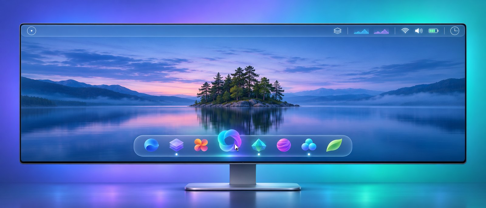
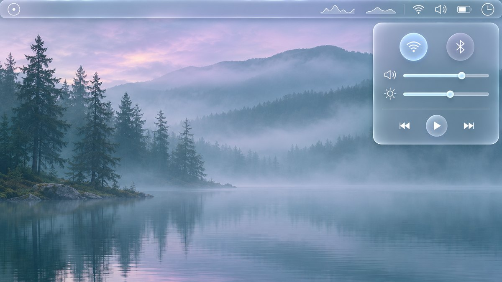
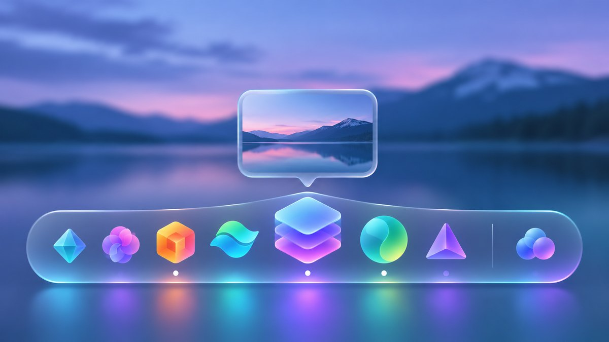

<div align="center">


# DeskIsle

**给 Windows 11 一座安静的桌面小岛**

半透明顶部状态栏 · 悬浮 Dock · 启动台 —— 用 Rust 自绘，静置时几乎零开销

[](https://github.com/Ariember/DeskIsle/releases/latest)
[](https://github.com/Ariember/DeskIsle/releases)
[](https://github.com/Ariember/DeskIsle/actions/workflows/release.yml)


[**下载**](https://github.com/Ariember/DeskIsle/releases/latest) · [功能](#-功能一览) · [安装](#-安装) · [使用指南](#-使用指南) · [常见问题](#-常见问题) · [开发](#-开发)

<br />



</div>

<br />

DeskIsle 是面向 Windows 11 的桌面工具，在主屏提供仿 macOS 的半透明顶部状态栏和底部 Dock。Dock 用于启动应用和切换窗口，状态栏集中显示应用托盘图标、资源监控、系统状态和时间。界面由 **DirectComposition** 合成、**Direct2D** 自绘，动画交给系统合成器执行。

<table>
<tr>
<td width="33%" valign="top">

### 🪶 轻
单个 `deskisle.exe`，免安装、免管理员权限、无额外运行时。静置时动画由系统合成器托管，几乎不占 CPU。

</td>
<td width="33%" valign="top">

### 🫧 美
光学液态玻璃折射与菲涅尔高光、悬停放大、窗口预览、图标倒影与 Dock 皮肤，每处背景都可单独调整。

</td>
<td width="33%" valign="top">

### 🧭 稳
被强制结束时，恢复进程会还原原生任务栏；自动更新下载后先校验再重启。

</td>
</tr>
</table>

## ✨ 功能一览

| 区域 | 提供的功能 |
| --- | --- |
| 🔝 **顶部状态栏** | 系统菜单与关于本机、前台应用名、应用托盘、资源监控、网络 / 声音 / 显示 / 电源面板、控制中心、输入法状态、时钟与日历 |
| ⚓ **Dock** | 固定与拖动排序、分割线分区、启动与切换窗口、多窗口列表、窗口预览、运行指示、悬停放大、多种显示隐藏模式 |
| 🚀 **启动台** | 拖入快捷方式或程序、名称搜索、翻页、从 Dock 拖入 |
| **插件** | 在管理面板查看已安装插件、浏览市场并一键安装、更新或移除桌面卡片。第三方程序也可通过本地接口更新或撤下卡片 |
| ⚙️ **管理面板** | 外观、主题、顶部栏、Dock、监控、时间等设置，改动立即生效并保存 |

<table>
<tr>
<td width="50%"></td>
<td width="50%"></td>
</tr>
<tr>
<td align="center"><b>顶部状态栏</b><br /><sub>托盘、资源监控、系统面板与控制中心</sub></td>
<td align="center"><b>Dock</b><br /><sub>固定、分区、窗口预览与悬停放大</sub></td>
</tr>
</table>

<p align="center"><sub>以上为风格示意图，实际界面以运行效果为准。</sub></p>

## 📋 系统要求

- Windows 11 x64。DeskIsle 以普通用户权限运行，无需管理员权限或额外运行时。
- 亮度调节需要显示器支持 DDC/CI。
- CPU 核心温度需要已运行的 [Core Temp](https://www.alcpu.com/CoreTemp/)。

## 📦 安装

### 下载发布版

在 [GitHub Releases](https://github.com/Ariember/DeskIsle/releases) 下载最新版本的 `deskisle.exe`，放到任意目录后直接运行，无需安装。发布版未做代码签名，首次运行时 SmartScreen 可能提示发布者未知。

如果 Windows 安全中心报告具体威胁或隔离了文件，请保留隔离，在“病毒和威胁防护”中更新安全情报，再从同一发布页重新下载并扫描。可用 `Get-FileHash .\deskisle.exe -Algorithm SHA256` 对照该版本下载项旁的 SHA-256。若仍有检出，请在项目 issue 中提供版本、威胁名称和安全情报版本，以便维护者向 Microsoft 提交复核。

支持自动更新的 x64 版本会在启动后检查稳定版，持续运行时每 24 小时再检查一次。发现新版时，选择“是”会下载、校验更新文件，并从原位置重启 DeskIsle。选择“否”可继续使用当前版本。自动更新需要对程序所在目录有写入权限，设置和固定项保存在原来的用户目录。

在管理面板的“常规”中可以关闭“自动检查更新”，也可以随时在“关于”中选择“检查更新”。较早版本的“关于”页只有发布页链接，首次升级需要手动下载。

### 从源码构建

需要 Rust stable 的 MSVC 工具链、Visual Studio C++ 生成工具和 Windows SDK。在仓库根目录运行：

```powershell
cargo run --release --locked
```

只需构建时，运行 `cargo build --release --locked`，生成的程序位于 `target\release\deskisle.exe`。

DeskIsle 默认在运行期间隐藏主屏的 Windows 任务栏，退出时恢复。可在「管理面板 → 常规」关闭“隐藏系统任务栏”。

如需随 Windows 启动，在「管理面板 → 常规」打开首项“开机自动启动”。下次登录当前账户时，Windows 会从当前位置启动 DeskIsle。

## 🧭 使用指南

### 🔝 顶部状态栏

- **系统菜单**。单击最左侧的圆环标志打开系统菜单。菜单打开期间，圆环轻按一下，中心长出一枚实心圆点，像湖心出现一座小岛；菜单关闭后圆点收回。菜单中可打开仿 macOS 的关于本机卡片（处理器、图形卡、内存和 Windows 版本）、DeskIsle 管理面板、Windows 设置、应用商店和任务管理器，也可显示桌面，或让电脑睡眠、重新启动、关机、锁定屏幕和注销。重新启动、关机和注销不强制关闭应用，有未保存工作的应用仍可提示。
- **前台应用**。标志右侧显示前台应用名称，点击可打开该应用的窗口列表或退出。
- **系统图标**。单击打开对应面板，查看或调整网络、声音、显示和电源等设置；右键直接打开对应的 Windows 设置页。在声音图标上滚动滚轮可调节音量，中键切换静音。电池图标的填充程度表示剩余电量，电量低时变为红色，充电时显示闪电；具体百分比在电池面板中查看。控制中心还提供常用开关和媒体控制。
- **托盘**。点击托盘图标右侧的列表按钮浏览应用托盘图标，列表展开时按钮变为实心。列表超过屏幕高度时，可用翻页按钮、滚轮或 Page Up / Page Down 浏览。点击行首图标切换是否常驻状态栏。点击应用名称或状态栏图标时，应用按自身托盘规则响应单击、双击和右键。列表只显示应用图标，会过滤 Windows 安全中心、系统蓝牙、安全删除硬件等系统状态项。应用提醒显示为静态圆点，左键点击可清除。
- **资源监控**。在「管理面板 → 监控」选择顶栏项目。监控图标位于应用托盘与系统图标之间，默认显示内存条形和 CPU 百分比。CPU、内存和磁盘活动支持条形、环形、曲线和数值。开启高占用提醒后，达到 90% 的项目会变色。
- **温度**。核心温度显示 Core Temp 共享的最高核心温度，勾选 GPU 可另外显示显卡驱动报告的温度。Core Temp 需提供绝对温度。未取得有效读数或计数器正在预热时，顶栏显示「—」。

### ⚓ Dock

- **启动与切换**。左键启动应用或切换窗口，多窗口时可从列表中选择。中键新开一个实例。
- **文件夹**。把文件夹拖到 Dock 的应用区域即可固定。点击后可分页浏览内容，选择文件可用默认应用打开，也可在文件资源管理器中打开整个目录。
- **固定与排序**。从桌面或资源管理器把应用或快捷方式拖到 Dock 的应用区域，图标会滑开留出空位，松开即可固定在该位置。按住 Dock 图标左右拖动可预览顺序，松开后保存；运行中的应用也可以拖入固定区。
- **分割符**。右键固定图标，选择“在右侧添加分割符”，即可用细竖线分区。也可右键 Dock 空白处或启动台按钮，选择“添加分割符”。按住分割线左右拖动可调整位置，右键选择“移除分割符”即可删除。可添加多条，顺序随固定应用一起保存。
- **右键菜单**。可固定或取消固定应用、打开文件位置。“关闭窗口”只关闭当前窗口，多窗口时菜单会显示目标标题。“退出程序…”打开该应用的托盘菜单，从中选择应用自己的退出命令；没有可用托盘菜单时，会请求关闭该组的全部窗口。保存提示和关闭后的后台驻留由应用决定。
- **显示隐藏**。在「管理面板 → Dock」选择模式，立即生效。

| 模式 | 行为 |
| --- | --- |
| 默认 | Dock 置顶显示 |
| 叠层 | 允许前台窗口遮住 Dock |
| 自动隐藏 | 停在主屏工作区底边任意位置即可唤出，可沿底边移向图标；离开底边和 Dock 后收起 |
| 智能隐藏 | 前台窗口与 Dock 重叠时收起，停在 Dock 正下方的工作区底边唤出 |
| 热键 | 用 Ctrl+Alt+D 切换显隐 |
| 桌面 | 仅在桌面位于前台时显示 |
| 始终显示 | 切换应用时将 Dock 重新置顶；需要在全屏应用上使用时选择“始终显示包括全屏” |

### 🚀 启动台

单击 Dock 左端的四格按钮打开启动台。将一个或多个 `.lnk`、`.exe` 或 `.url` 文件拖到四格按钮或已打开的启动台，松开即可加入列表。拖入时四格按钮抬起，已打开的启动台会显示接收提示；添加成功后，按钮会轻轻回弹。重复拖入同一路径只保留一项。也可以把 Dock 上的应用拖到启动台，原有固定位置会保留。需要取文件时可用 Alt+Tab 切换窗口。

直接输入名称搜索，用滚轮或底部圆点翻页。右键图标可从列表移除，原文件保留。按 Esc 或再次单击启动台按钮即可关闭。

### ⚙️ 管理面板与退出

右键顶部栏标志，或点击栏空白处打开菜单，选择“设置”或“退出 DeskIsle”。也可在系统菜单中选择“管理面板”。

- **常规**：在“玻璃背景模糊”中统一调整 Dock、顶部栏和玻璃面板。0% 保留清晰背景与折射边缘，提高强度会柔化玻璃后方的纹理。此页也可设置界面大小、颜色、字体、温度单位、开机启动、自动检查更新、主屏任务栏和最近文档。
- **主题**。可分别调整 Dock、图标标签、菜单、文件夹、窗口预览、顶部栏与启动台的背景，设置 Dock 图标倒影、文件夹图标大小，并选择内置图标主题和 Dock 皮肤。关闭自定义开关会保留该组数值。
- **顶部栏**：预览渐变遮罩、液态玻璃和透明背景，调整栏高，开启最大化窗口配色、右上角关闭按钮和关机重启确认；切换托盘图标原色、输入法、中英文状态和启动台搜索入口。托盘图标解锁后可拖动到另一图标的位置调整顺序。系统未启用透明效果或无法提供液态玻璃时，背景显示为纯色。
- **Dock**：图标大小、间距、底部留白、悬停放大和显示隐藏模式。
- **监控**：顶栏监控项目、显示样式和高占用提醒。
- **插件**。在插件页可集中查看本地已安装的插件与卡片状态，浏览 GitHub 上最新稳定版市场提供的卡片，一键安装、更新或移除；已开启“显示桌面卡片”的主屏会立即刷新卡片显示，也可直接打开当前用户的插件目录。[市场发布页](https://github.com/Ariember/DeskIsle-PluginMarket/releases) · [插件协议与命令行用法](docs/plugins.md)
- **时间**：时钟格式预览，仅本次运行有效。
- **关于**：查看当前 DeskIsle 版本、检查更新、打开 GitHub 项目主页或版本发布页。选择“退出程序”会退出 DeskIsle 并恢复系统任务栏。

## ❓ 常见问题

- **托盘图标一直显示“仅显示”，或顶部栏提示权限受限**。标为“仅显示”的图标仍可固定，应用注册点击回调后即可操作。如果一直无法操作，可在设置中关闭“隐藏系统任务栏”，从 Windows 原生通知区域操作。
- **托盘菜单位置或内容不一致**。托盘菜单由所属应用绘制，菜单位置和可用操作取决于应用。
- **亮度滑块不可用**。亮度调节需要显示器支持 DDC/CI。
- **点击“睡眠”后屏幕关闭但没有立即睡眠**。在支持现代待机的电脑上，DeskIsle 会请求关闭屏幕，随后由 Windows 按电源策略进入低功耗状态。
- **DeskIsle 被强制结束后**。恢复进程会感知主进程退出并还原原生任务栏。Explorer 可能暂时保留顶部预留的条带。

## 🧹 卸载

1. 在「管理面板 → 常规」关闭开机启动。
2. 从菜单选择“退出 DeskIsle”，任务栏和工作区会恢复。
3. 删除 `deskisle.exe`。如需清除配置，再删除 `%APPDATA%\DeskIsle\`。

## 🗂️ 本地配置

配置保存在 `%APPDATA%\DeskIsle\`，开机自动启动状态由当前用户的 Windows 注册表启动项管理。

| 文件 | 内容 |
| --- | --- |
| `settings.ini` | 外观与行为设置 |
| `pins.txt` | Dock 固定应用和分割符的顺序 |
| `launchpad.txt` | 按添加顺序保存的启动台项目原始路径 |
| `plugins\<id>.json` | 一个插件的元数据和已发布的扩展内容 |
| `tray-hidden.txt` | 隐藏的托盘图标 |
| `tray-order.txt` | 用户调整过的托盘图标顺序 |

## 🛠️ 开发

开发前阅读[开发规范](AGENTS.md)、[开发选型](docs/technology.md)和[架构规范](docs/architecture.md)。代码按以下层次组织：

| 目录 | 职责 |
| --- | --- |
| `src/ui/`、`src/render/` | 展现层：布局、命中、菜单模型与 Direct2D / DirectComposition 渲染 |
| `src/app/` | 应用层：启动、事件、命令和恢复流程 |
| `src/dock.rs` 等 | 领域层：纯 Rust 的状态与规则，可独立测试 |
| `src/platform/`、`src/integrations/`、`src/storage/` | 适配层：Windows 与 Shell、外部服务、设置文件读写 |

交付前运行：

```powershell
cargo fmt --check
cargo clippy --all-targets --locked -- -D warnings
cargo test --locked
```

在交互式 Windows 桌面上，可运行 `cargo test --locked --test windows_bars -- --ignored` 验证双栏位置和工作区恢复。

<details>
<summary><b>自动发布</b></summary>

<br />

向 `main` 提交 PR 或推送代码时，GitHub Actions 会在 Windows x64 上运行格式检查、Clippy、测试和 Release 构建。需要交互式桌面的测试仍由开发者在本机运行。

发布新版本时，更新 `Cargo.toml` 的 `[package].version`，运行 `cargo check` 同步 `Cargo.lock`，将两者一起合入 `main`。工作流在发布前更新 Microsoft Defender 安全情报并扫描待上传的 `deskisle.exe`，检出威胁或检查失败会中止发布。通过后，工作流在本次提交上创建 `v<版本号>` 标签和 GitHub Release，生成发布说明，并附上该文件。已发布的版本会跳过，带预发布标识的版本（如 `0.2.0-beta.1`）会标记为预发布。

</details>

## 📚 项目文档

- [开发规范](AGENTS.md)
- [开发选型](docs/technology.md)
- [架构规范](docs/architecture.md)

<div align="center">

<br />


<sub>Made with Rust for Windows 11 · 如果 DeskIsle 让你的桌面更安静一点，欢迎点一颗 ⭐</sub>

</div>
